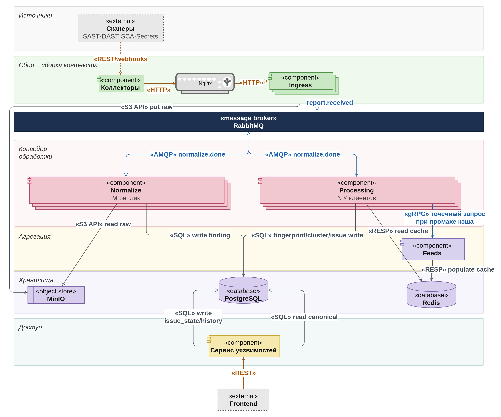

# VulnManager

## 1. Описание проекта

### Что это и для кого

VulnManager — система управления уязвимостями.
Он принимает отчёты сканеров безопасности (SAST, SCA, секреты, IaC), приводит находки разных
инструментов к единому виду и склеивает дубликаты в кластеры, чтобы одна проблема, найденная
несколькими сканерами или в нескольких запусках, не считалась несколько раз.

Для кого: команды разработки и безопасности, у которых большое количество сканеров и повторяющиеся
запуски. Задачи, которые решает система:

- принять отчёт сканера по HTTP и не потерять его (сырой отчёт сохраняется, повторная отправка
  того же отчёта распознаётся);
- разобрать отчёт и нормализовать находки: серьёзность, идентификатор уязвимости, компонент (purl),
  путь, правило, CWE, оценка CVSS v2, v3.x и v4.0;
- посчитать отпечатки находок и склеить дубликаты в кластеры с оценкой уверенности
  и перечнем причин слияния.

### Стек технологий

| Область | Технологии |
|---|---|
| Сервисы | Go 1.23, `net/http`, sqlc, pgx |
| Контракты | OpenAPI 3.1 (HTTP), Protocol Buffers и buf (события) |
| Хранилища | PostgreSQL 16, S3-совместимое хранилище сырых отчётов (в стенде Garage) |
| Очередь | RabbitMQ 3.13 |
| Миграции | pgmigrate |
| Наблюдаемость | Prometheus-метрики (`/metrics`), структурированные JSON-логи |
| Поставка | `.deb` через `dpkg-buildpackage`, Docker-образы, Docker Compose |
| Тесты и CI | `go test`, pytest, yandex-taxi-testsuite, GitHub Actions |

### Архитектура



Схема показывает целевую архитектуру. Реализованы `ingest` (на схеме «Ingress»), `normalize`,
`processing`, RabbitMQ, PostgreSQL и хранилище сырья. Коллекторы, Nginx, Feeds, Redis, сервис уязвимостей и Frontend
запланированы.

Как компоненты взаимодействуют:

1. `ingest` принимает отчёт по HTTP (`POST /api/v1/reports`), кладёт его в хранилище сырья
   и записывает задание в PostgreSQL. В RabbitMQ уходит событие `report.received` с ссылкой
   на сырьё, а не с телом отчёта.
2. `normalize` получает событие, читает сырой отчёт, разбирает его парсером инструмента,
   нормализует находки и записывает их в PostgreSQL. После прогона публикует `import.completed`.
3. `processing` получает `import.completed`, считает отпечатки находок и склеивает дубликаты
   в кластеры внутри области видимости (продукт и контекст).

Один и тот же отчёт того же инструмента в ту же область принимается как повтор и не создаёт
нового прогона.

### Поддерживаемые инструменты

| Инструмент | Формат отчёта | `X-Tool` |
|---|---|---|
| Trivy 0.75.0 | JSON (`--format json`) | `trivy` |
| Semgrep 1.180.0 | SARIF (`--sarif`) | `semgrep` |

Любое другое имя инструмента (в формате `^[a-z0-9][a-z0-9._-]{0,63}$`) принимается, но
отчёт не разбирается: создаётся одна находка «unparsed report» с диагностикой `unknown_format`.

### Точки расширения

Новый инструмент подключается через реестры, ключ в них — значение `X-Tool`.

- **`normalize`:** реестр адаптеров (`services/normalize/internal/adapters`) сопоставляет инструмент
  с парсером и цепочкой нормализаторов; для неизвестного инструмента используется запасной адаптер.
  Регистрация в `adapters/tools.go`.
- **`processing`:** реестр наборов отпечатков (`services/processing/internal/fingerprint`)
  сопоставляет инструмент со стратегиями отпечатков; для неизвестного используется запасной набор;
  повторная регистрация имени возвращает ошибку.
  Регистрация в `services/processing/internal/adapters/tools.go`.

## 2. Запуск и развёртывание

### Требования к окружению

Для запуска стенда:

| Что | Версия |
|---|---|
| Docker с Docker Compose v2 | проверено на Docker 29.5 |
| GNU make | любая |
| Свободные порты | 5432, 5672, 15672, 3900, 8080, 8081, 8082 |

Порты сейчас открыты на хост только для тестирования системы: для работы стенда снаружи нужен
один порт, `8080` (приём отчётов). Если он занят, задайте другой: `INGEST_PORT=18080 make up`. Остальные (PostgreSQL, RabbitMQ и его консоль, S3, `/ping`
и `/metrics` у `normalize` и `processing`) позволяют смотреть данные и очереди во время проверки.
В промышленном развёртывании наружу будет открыт только вход.

Go на машине ставить не нужно: сервисы собираются в контейнере `golang:1.23.6`. Если собираете
сервисы без Docker, нужен Go 1.23.6.

Сквозные тесты (`make e2e`) тоже запускаются в контейнере: Python и зависимости ставить не нужно.

### Переменные окружения и конфигурация

Для локального стенда значения лежат в `deploy/local/*.env` (подключаются в `docker-compose.yaml`);
пароли и ключи там фиктивные, только для разработки. Шаблон для запуска вне Docker:
`services/ingest/.env.example`.

`ingest`:

| Переменная | Назначение | По умолчанию |
|---|---|---|
| `INGEST_ADDR` | адрес HTTP | `:8080` |
| `INGEST_DATABASE_URL` | строка подключения к PostgreSQL | обязательна |
| `INGEST_TENANT` | идентификатор тенанта | обязательна |
| `INGEST_RAWSTORE` | хранилище сырья: `s3` или `pg` | `s3` |
| `INGEST_S3_ENDPOINT`, `INGEST_S3_ACCESS_KEY`, `INGEST_S3_SECRET_KEY`, `INGEST_S3_BUCKET`, `INGEST_S3_SSL` | доступ к S3 | обязательны при `s3` |
| `INGEST_AMQP_URL`, `INGEST_AMQP_EXCHANGE` | RabbitMQ | URL обязателен |

`normalize`:

| Переменная | Назначение | По умолчанию |
|---|---|---|
| `NORMALIZE_ADDR` | адрес HTTP | `:8081` |
| `NORMALIZE_DATABASE_URL` | PostgreSQL | обязательна |
| `NORMALIZE_S3_ENDPOINT`, `NORMALIZE_S3_ACCESS_KEY`, `NORMALIZE_S3_SECRET_KEY`, `NORMALIZE_S3_BUCKET`, `NORMALIZE_S3_SSL` | чтение сырья | обязательны |
| `NORMALIZE_AMQP_URL`, `NORMALIZE_AMQP_EXCHANGE`, `NORMALIZE_AMQP_QUEUE` | входящие события | URL обязателен |
| `NORMALIZE_EVENTS_EXCHANGE` | обменник исходящих событий `import.completed` | `vulnmanager.import.completed` |
| `NORMALIZE_WORKER_ID` | имя воркера | имя хоста |
| `NORMALIZE_PREFETCH`, `NORMALIZE_MAX_ATTEMPTS` | параллелизм, число попыток | `4`, `5` |

`processing`:

| Переменная | Назначение | По умолчанию |
|---|---|---|
| `PROCESSING_ADDR` | адрес HTTP | `:8082` |
| `PROCESSING_DATABASE_URL` | PostgreSQL | обязательна |
| `PROCESSING_AMQP_URL`, `PROCESSING_AMQP_EXCHANGE`, `PROCESSING_AMQP_QUEUE` | входящие события | URL обязателен |
| `PROCESSING_WORKER_ID` | имя воркера | имя хоста |
| `PROCESSING_PREFETCH`, `PROCESSING_RETRY_DELAY` | параллелизм, задержка повтора | `4`, `1m` |

### Сборка и запуск

```bash
git clone https://github.com/SeniorPomidorDeveloper/VulnManager.git
cd VulnManager
make up              # собрать .deb и образы и поднять стенд
make ps              # состояние контейнеров
make logs            # логи (SERVICE=ingest для одного сервиса)
make down            # остановить, данные сохраняются
make clean           # остановить и удалить данные
```

`make up` по очереди собирает `.deb`-пакеты сервисов, из них собирает образы и поднимает через
Docker Compose PostgreSQL, RabbitMQ, хранилище сырья, миграции и три сервиса.
`make help` показывает все цели.

### Как убедиться, что сервис поднялся

```bash
make ps                                  # все сервисы healthy / running
curl -sS http://127.0.0.1:8080/ping      # ingest, ответ: ok
curl -sS http://127.0.0.1:8081/ping      # normalize
curl -sS http://127.0.0.1:8082/ping      # processing
curl -sS http://127.0.0.1:8080/metrics   # метрики Prometheus
```

Сквозная проверка: отправьте отчёт из корпуса, в ответ придёт `202` и `scan_id`.

```bash
curl -sS -X POST http://127.0.0.1:8080/api/v1/reports \
  -H 'X-Tool: semgrep' -H 'X-Scope: demo/main' \
  --data-binary @testdata/corpus/semgrep/1.180.0/juice-shop.sarif
```

Для своих отчётов подставьте `<tool_name>`, `<product>/<context>` и `@<report_file>`.
Консоль RabbitMQ: http://127.0.0.1:15672 (логин и пароль в `deploy/local/rabbitmq.env`).

### Тесты

```bash
make test            # юнит-тесты и линтеры (в Docker)
make e2e             # сквозные тесты в контейнере, перед запуском нужно поднять стенд (make up)
make integration     # в каталоге ingest, normalize или processing, стенд не нужен
```

| Вид | Где |
|---|---|
| Юнит и golden | `*_test.go`, `services/normalize/internal/parsers/testdata/golden` |
| Контрактные сьюты точек расширения | `parsertest`, `normtest`, `fptest`, `deduptest` |
| Интеграционные | `services/{ingest,normalize,processing}/tests/integration` |
| Сквозные | `tests/e2e` |

Для e2e-тестов сначала нужно поднять стенд (`make up`): `make e2e` сам его не поднимает, а только
собирает образ с тестами и запускает их.

## 3. Выполнено к 8 неделе

**Приём отчётов (`ingest`)**
- HTTP-приём `POST /api/v1/reports` по контракту OpenAPI, проверка заголовков (`X-Tool`, `X-Scope`).
- Сохранение сырого отчёта в S3 или PostgreSQL, квота на размер отчёта для тенанта.
- Идемпотентность: повторный отчёт распознаётся по хешу, инструменту и области.
- Очередь заданий в PostgreSQL и событие `report.received` в RabbitMQ с метриками публикации.

**Нормализация (`normalize`)**
- Сервис `normalize`: чтение сырья из S3, реестр парсеров, generic-парсер для неизвестных инструментов,
  адаптеры SARIF (Semgrep) и Trivy, обработка событий `report.received` из RabbitMQ.
- Нормализаторы: серьёзность, идентификатор уязвимости, путь, компонент (purl), правило и CWE,
  фрагмент кода.
- Расчёт оценок CVSS v2, v3.x и v4.0 и политика выбора серьёзности.
- Запись прогонов и находок, публикация `import.completed`, метрики воркера.

**Обработка (`processing`)**
- Отпечатки находок трёх уровней и набор стратегий по инструменту.
- Дедупликация: поиск кандидатов, признаки и скорер, профили весов
  по виду находки, кластеризация; номер строки как признак.
- Метрики воркера, бэклога и кластеризации.

**Инфраструктура и качество**
- Общая БД `db/vulnmanager` с 15 миграциями (pgmigrate).
- Поставка: `.deb` через `dpkg-buildpackage`, образы, Docker Compose
  (профили `infra`, `core`).
- Общий `Makefile`: `make up`, `make test`, `make e2e`.
- Тесты: юнит, интеграционные на testsuite, сквозные на pytest.
